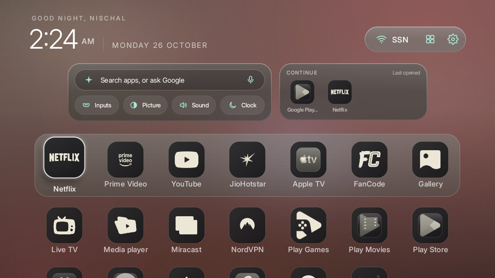
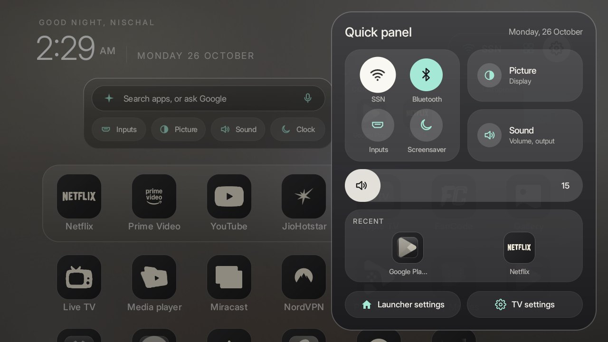
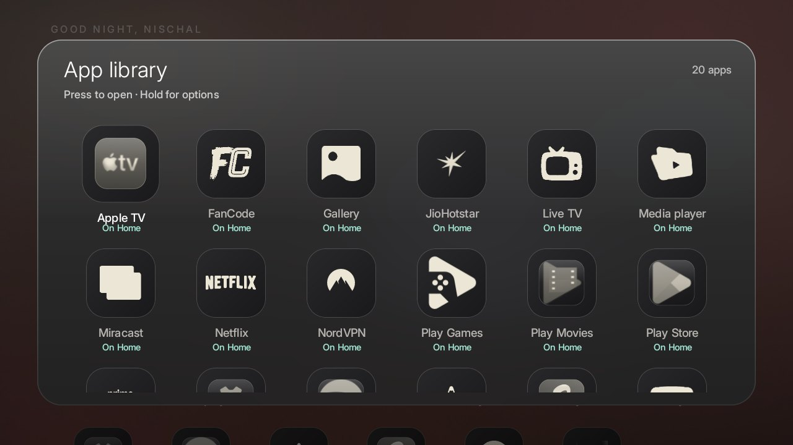

<p align="center"></p>

<h1 align="center">Glasshouse</h1>
<p align="center"><b>A calm, glass home screen for Android TV and Google TV. No ads, no clutter, installed over Wi‑Fi.</b><br>
<a href="https://nicholascallum22.github.io/glasshouse/">Website</a> · <a href="#install">Install</a> · <a href="#whats-in-it">Features</a> · <a href="NOTICE.md">Credits</a></p>

---

The stock Google TV home is a billboard: rows of sponsored shows, "recommended for you", and the apps you
actually use buried at the bottom. Glasshouse replaces it with a quiet glass home screen. Your apps sit in tinted
squircles, the background takes on the colour of whatever you focus, and the things you reach for are one press
away.

It is built on [CleanYourTV](https://github.com/Gathin23/cleanyourtv)'s small native launcher (about 500 KB, no
network permission, no background services), so it runs well on a 2 GB TV.

## What's in it

| | |
|---|---|
| **Glass app tiles** | Every app in one tinted squircle style, its own mark lifted onto dark glass. |
| **Colour wash** | The whole screen takes a soft pastel of the focused app's colour, morphing as you move. |
| **Home center** | Search or ask Google, Inputs, Picture, Sound and the screensaver, plus the apps you opened last. |
| **Now Playing** | While music plays, the clock and the track take turns in the corner, with play/pause in the album art's colour. |
| **Quick panel** | The remote's Settings button opens Wi‑Fi, Bluetooth, inputs, picture, sound, a sleep timer and the volume, over any app. |
| **App library** | Every installed app in a frosted glass grid; add or remove apps from Home. |
| **Remote shortcuts** | Colour buttons open apps; the App library button opens the library. |
| **Soft motion** | Slow, gentle fades and a slight tilt and sheen on focus, tuned for a TV's GPU. |

<p align="center">
 
</p>

## Install

You need a computer on the same Wi‑Fi as the TV, and **USB debugging** on the TV (Settings → System → About →
press OK on *Build* seven times, then Developer options → USB debugging).

```bash
git clone https://github.com/NicholasCallum22/glasshouse && cd glasshouse
./install.sh 192.168.1.50          # your TV's IP address
```

Building from source needs JDK 17 and the Android SDK (platform 34). The installer does the rest in the safe order
Google TV needs: it checks that the setup wizard doesn't own your Wi‑Fi, turns the wizard off while the stock
launcher is still Home, hands Home to Glasshouse and rolls back if that doesn't stick, then turns on the remote
buttons, Now Playing and the theme.

**Glasshouse Pro** skips the build: a ready-made APK, the one-command installer and every theme, for people who
don't want to set up Java and the Android SDK. See the [website](https://nicholascallum22.github.io/glasshouse/).

Undo everything at any time, and always before a factory reset:

```bash
./uninstall.sh 192.168.1.50        # REMOVE=1 also uninstalls Glasshouse
```

## Themes

`themes/glasshouse` is the full look; `themes/lumen` and `themes/default` are alternatives. Every switch is
documented in [`themes/README.md`](themes/README.md), and a theme changes without a rebuild:

```bash
TV_HOST=192.168.1.50 tools/theme.sh themes/glasshouse
```

## Tested on

Xiaomi MiTV-AXFU0, Google TV 14 (Android 14). Other Android TV and Google TV sets should work as they do with
CleanYourTV; its [device lists](https://github.com/Gathin23/cleanyourtv/tree/main/examples) cover about 290 models
and also help with removing bloat. On some sets (this Xiaomi among them) the system draws its own volume bar,
which no launcher can restyle.

## Credits

Built on [CleanYourTV](https://github.com/Gathin23/cleanyourtv) by Gathin (MIT). Glasshouse is independent and not
endorsed by CleanYourTV. Fonts and other notices: [NOTICE.md](NOTICE.md). MIT licence: [LICENSE](LICENSE).
