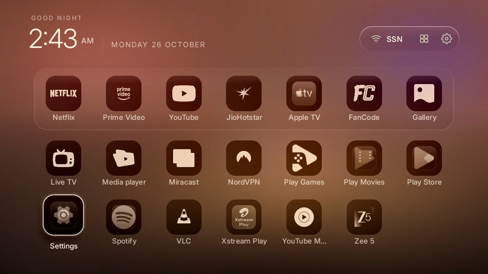
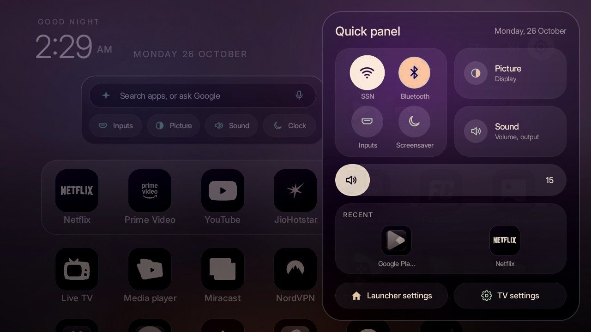
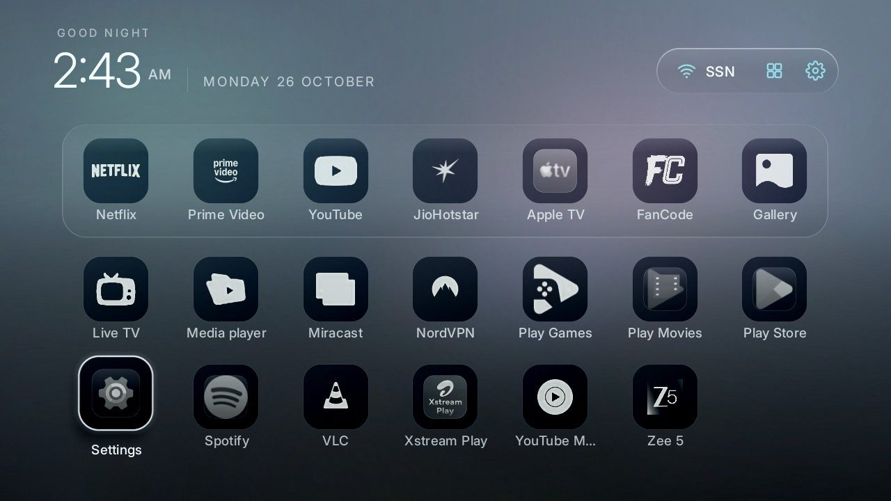
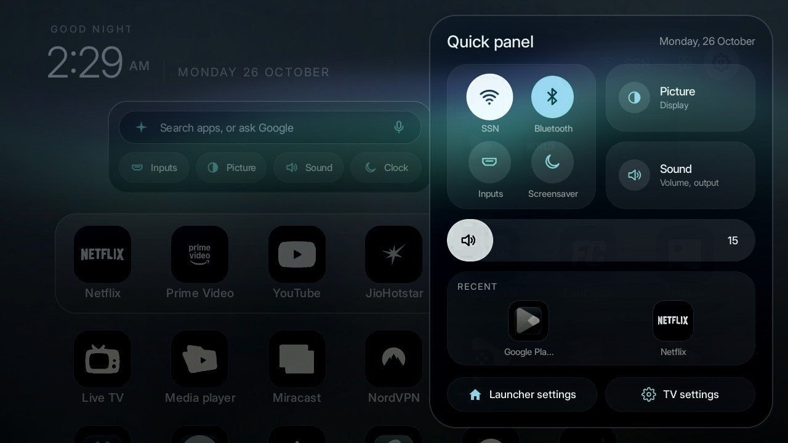
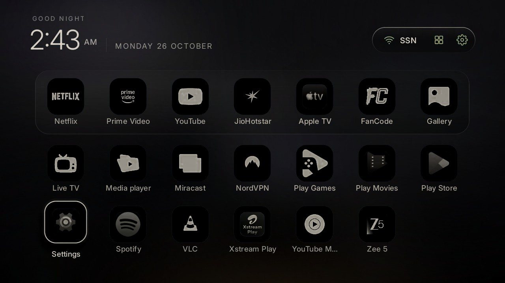
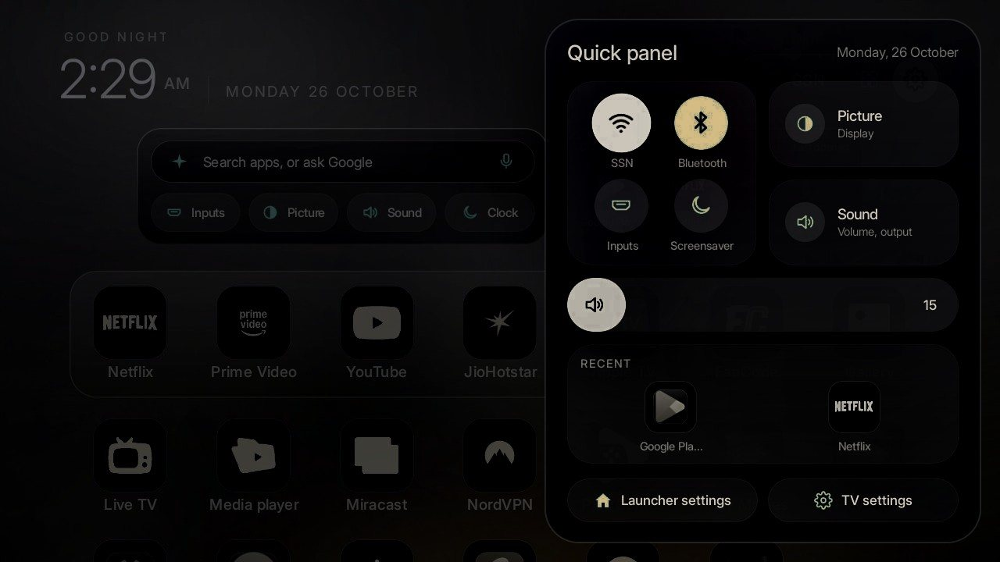

# Glasshouse Pro themes

Three extra themes for Glasshouse, sold as the **Glasshouse Pro** pack. Every Glasshouse feature stays free and
MIT licensed in this repo; Pro adds these themes and a ready-made APK, and pays for keeping Glasshouse working on
new TVs and firmware. Get it from the [website](https://nicholascallum22.github.io/glasshouse/#pricing).

Each theme has a morning, an evening and a night wallpaper. Glasshouse shows the morning one from sunrise to noon,
the evening one until half an hour after sunset, and the night one after that.

| Theme | Evening | Night |
| --- | --- | --- |
| **Dusk**: golden hour that never leaves the room. Peach mornings, an amber evening sun low behind the dock, plum nights. Ivory icons, apricot accent, rim focus. |  |  |
| **Fjord**: Nordic daylight. Morning mist, a slate dusk, an aurora at night. Frost-white icons, glacier accent, halo focus, six roomier tiles to a row. |  |  |
| **Obsidian**: for OLED and dark rooms. Black glass with one streak of light and a thread of gold; the clock screensaver sits on true black. |  |  |

The previews are simulated on a real Glasshouse screenshot, so tile counts and exact colours can differ a little
on your TV.

## After you buy

1. Install Glasshouse with this repo's `install.sh` (or `APK=Glasshouse.apk ./install.sh <TV IP>` with the APK
   from the pack).
2. Copy `themes/dusk`, `themes/fjord` and `themes/obsidian` from the pack into this repo's `themes/` folder.
3. Run `TV_HOST=<TV IP> tools/theme.sh themes/dusk` (or fjord, or obsidian). Switch back with `themes/glasshouse`.

The theme files are not in this repo; they come with the pack under a licence for your own household.
